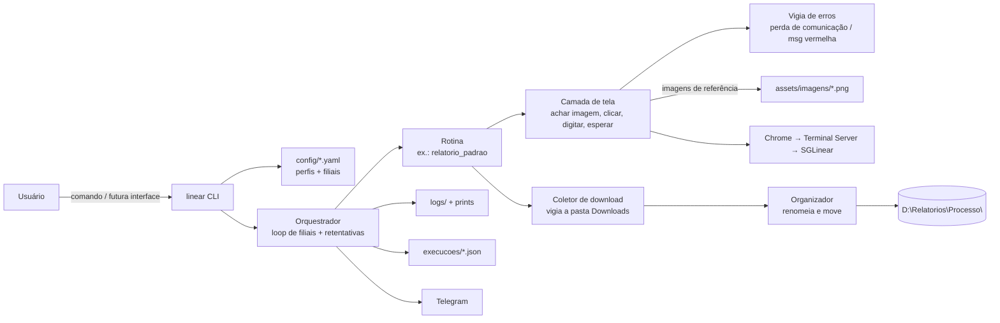

# TRD — Automações Linear (requisitos técnicos)

- **Versão:** 1.1
- **Data:** 2026-11-10
- **Status:** aprovado
- **Base:** PRD v1.0

---

## 1. Stack escolhida

| Peça | Escolha | Por quê | Alternativa descartada |
|---|---|---|---|
| Linguagem | **Python 3.13** (já instalado no PC) | Pedido do usuário; tem bibliotecas maduras de RPA | — |
| Controle de mouse/teclado | **pyautogui** | Simples, estável, tem a "parada de emergência" (mouse no canto da tela = para tudo, RF-14) | pywinauto: precisa dos elementos da janela, que **não existem** aqui (Terminal Server mostra só imagem) |
| Reconhecimento de imagem | **OpenCV** (via `pyautogui.locateOnScreen(..., confidence=0.9)`) | Acha botões e mensagens na tela a partir de pequenos recortes (prints de referência) | Coordenadas fixas: quebram com qualquer deslocamento de janela |
| Leitura de texto na tela (OCR) | **Nenhuma na V1**. Se for necessário, **RapidOCR** depois | Recortes de imagem bastam para os botões e as mensagens. OCR só entra se precisarmos ler um texto que muda | Tesseract: exige instalar um programa à parte no Windows |
| Configuração (perfis, filiais) | **Arquivos YAML** (texto simples e legível) em `config/` | Você consegue editar à mão; perfil novo = arquivo novo (RN-08) | Banco de dados: desnecessário para poucos itens na V1 |
| Histórico das execuções | **Arquivo JSON por execução** em `execucoes/` | Simples e fácil de ler depois pela interface | SQLite: entra quando a interface visual exigir consultas (ver item 7) |
| Logs | Módulo `logging` do Python + **print da tela** em cada erro | Nativo e sem dependência | — |
| Aviso | **Bot do Telegram** pela API HTTP (`requests`) | Pedido do usuário; uma chamada HTTP simples | Biblioteca python-telegram-bot: pesada para só enviar mensagens |
| Execução | Linha de comando: `python -m linear run <perfil> --filiais 3,4 --modo individual` | Rápido de construir e testar; a interface futura vai chamar o mesmo comando | — |
| Interface futura (RF-16) | **Decidir depois dos testes**. Candidatos: Streamlit (painel web local, simples) ou app web com FastAPI | Fora do escopo da V1 | — |
| Versionamento/backup | **Git + GitHub** — `G-Mitter/automacoes-Linear` (público) | Pedido do usuário | — |

## 2. Como as peças se conectam



**Camadas** (cada uma só conversa com a de baixo):
1. **Camada de tela** (`linear/tela.py`): `esperar_imagem`, `clicar_imagem`, `digitar` e `tecla`. Toda espera tem um tempo máximo e, enquanto espera, chama o **vigia de erros**.
2. **Vigia de erros** (`linear/erros.py`): reconhece as mensagens conhecidas pela imagem. Na "perda de comunicação", espera a mensagem sumir (até o tempo máximo, D-05). Na "mensagem vermelha", fecha a mensagem e avisa o orquestrador (lança `ErroRecuperavel`).
3. **Rotinas** (`linear/rotinas/*.py`): os passos de uma tela de relatório (abrir, escolher modelo, filiais, exportar, descarregar). Recebem os parâmetros do perfil.
4. **Orquestrador** (`linear/orquestrador.py`): percorre as filiais, aplica as 3 tentativas (RN-07), reabre a tela entre as tentativas, registra o resultado, avisa no Telegram e nunca para a execução por falha de uma filial.

**Rotina × perfil (RN-08):**
- **Rotina** = código, um por tipo de tela.
- **Perfil** = YAML com `rotina`, `processo`, `menu`, `modelo_filtro`, `formato`, `modo_filiais` e `filiais_padrao`.

Uma variação de filtro vira um novo modelo salvo no ERP e um novo YAML, sem código novo.

## 3. Integrações externas
| Integração | Como | Observação |
|---|---|---|
| SGLinear (via Chrome + Terminal Server) | Só pela tela: imagem + mouse/teclado | Não há API |
| Download do Terminal Server | Janela "Descarregar arquivo" → o Chrome salva em `C:\Users\TI\Downloads` | O coletor vigia a pasta e pega o arquivo **novo** e **completo** (ignora `.crdownload`). O Chrome pode criar `nome (1).xlsx`, e isso é tratado |
| Telegram | `POST https://api.telegram.org/bot<TOKEN>/sendMessage` | Token e chat_id ficam em `.env`, fora do GitHub |
| GitHub | `git push` para `G-Mitter/automacoes-Linear` | Repositório público: **nada de dados de empresa, token ou relatório** no repositório |

## 4. Requisitos não funcionais
- **Ambiente de tela fixo:** a resolução, a escala do Windows e o zoom do Chrome precisam ficar sempre iguais aos usados para tirar as imagens de referência (D-06). O robô confere isso no início e avisa se estiver diferente.
- **Esperas inteligentes:** nunca usar só `sleep` fixo. Sempre "esperar a imagem X aparecer" com tempo máximo configurável.
- **Parada de emergência:** levar o mouse ao canto superior esquerdo interrompe a execução (FAILSAFE do pyautogui). Ctrl+C no terminal também.
- **Segurança:**
  - `.env` com o token do Telegram fica no `.gitignore`;
  - relatórios, logs, prints e `execucoes/` também ficam no `.gitignore` (podem ter dados da empresa e o repositório é público);
  - o robô não guarda nem digita senhas.
- **Logs:**
  - um arquivo de log por execução em `logs/AAAA-MM-DD_HHMMSS.log`;
  - um print da tela a cada erro em `logs/prints/`;
  - os logs são guardados por 90 dias e apagados depois (configurável).
- **Backup:** o código vai para o GitHub a cada etapa concluída. Os relatórios ficam na pasta base, cujo backup é do usuário.
- **Desempenho:** sem meta rígida. O alvo é ficar perto do tempo humano por filial e não ser mais lento que ele.

## 5. Estrutura de pastas
```
automacaoLinear/
├─ docs/                    # os 6 documentos
├─ linear/                  # código
│  ├─ __main__.py           # CLI
│  ├─ tela.py  erros.py  orquestrador.py  downloads.py  organizador.py  telegram.py  config.py
│  └─ rotinas/relatorio_padrao.py
├─ assets/imagens/          # recortes de referência (botões, mensagens)
├─ config/
│  ├─ geral.yaml            # pasta base, filiais ativas, tempos de espera
│  └─ perfis/curva_abc.yaml
├─ ferramentas/capturar.py  # ajuda a recortar as imagens de referência
├─ logs/  execucoes/        # ignorados pelo git
├─ .env.example  .gitignore  requirements.txt  README.md
```

## 6. Como rodar localmente
1. Abra o Chrome no Terminal Server, com o SGLinear logado na **tela inicial**, maximizado e com o zoom padrão.
2. No PowerShell, rode uma vez:
   ```bash
   cd C:\repositorios\automacaoLinear
   py -3.13 -m venv .venv
   .venv\Scripts\python -m pip install -r requirements.txt
   copy .env.example .env
   ```
   Depois, preencha `TELEGRAM_TOKEN` e `TELEGRAM_CHAT_ID` no `.env`.
3. Para executar, use o atalho `linear.cmd`. Ele chama o Python do `.venv` sem precisar ativar o ambiente, porque o PowerShell deste PC bloqueia scripts `.ps1`:
   ```bash
   .\linear run curva_abc --filiais 3,4,6 --modo individual
   ```
4. Para rodar de novo só as filiais que falharam (RF-15):
   ```bash
   .\linear rerun <id_execucao>
   ```

**Variáveis (`.env`):** `TELEGRAM_TOKEN`, `TELEGRAM_CHAT_ID`.
**Configuração (`config/geral.yaml`):** `pasta_base`, `filiais_ativas`, `tentativas: 3`, `espera_max_comunicacao_s: 180`, `pasta_downloads`.

## 7. Onde evoluir no futuro
- **Interface visual:** Streamlit ou FastAPI, chamando o orquestrador. O histórico das execuções passa de JSON para **SQLite** quando a interface precisar filtrar e consultar.
- **OCR (RapidOCR):** se for preciso ler valores ou mensagens que mudam.
- **Agendamento:** pelo Agendador de Tarefas do Windows chamando o mesmo comando, se sair do "Fora do escopo".
- **Rodar numa máquina dedicada ou VM:** evita o conflito com o uso humano do PC (RN-10).

## 8. Dúvidas técnicas em aberto
- D-06 (PRD): resolução **1920x1080** (definida). Ainda falta confirmar a escala do Windows (100%?) e o zoom do Chrome (100%?).
- Confirmar que `C:\Users\TI\Downloads` é sempre o destino do Chrome e que ele não pergunta onde salvar.
- Confirmar se o "Descarregar arquivo" lista a pasta do servidor onde o ERP salvou o arquivo (no vídeo ela abriu em "Downloads" do servidor).

---

## Histórico de mudanças
| Versão | Data | Mudança |
|---|---|---|
| 0.1 | 2026-11-10 | Primeiro rascunho |
| 1.0 | 2026-11-10 | Aprovado; resolução 1920x1080 registrada |
| 1.1 | 2026-11-10 | Execução pelo atalho `linear.cmd` (o PowerShell bloqueia o `activate`); `rich` adicionado às dependências |
