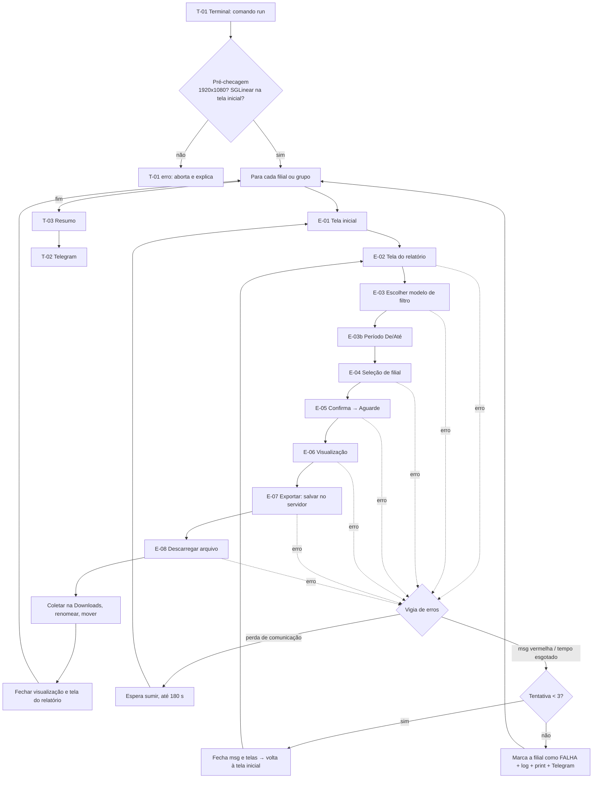

# Fluxo — Automações Linear

- **Versão:** 1.1
- **Data:** 2026-11-10
- **Status:** rascunho (aguardando aprovação)
- **Base:** PRD v1.0, TRD v1.0

---

Na V1 não há interface visual própria (RF-16 está fora do escopo). Por isso este documento descreve dois tipos de "tela":
- **Telas do robô (T-01 a T-03):** o que você vê e usa, ou seja, o terminal, o Telegram e o resumo.
- **Telas do ERP (E-01 a E-08):** o caminho que o robô percorre no SGLinear, com o que ele procura e o que faz em cada uma.

Os passos E-xx baseiam-se no vídeo do **Relatório de Produtos**. A Curva ABC deve seguir o mesmo padrão. O caminho exato no menu é a dúvida D-01 e será ajustado quando você enviar.

## 1. Mapa de navegação

## 2. Telas do robô

### T-01 — Terminal (linha de comando)
**Objetivo:** iniciar e acompanhar uma execução. **RF:** 01, 03, 07, 14, 15.

**O que aparece:** o perfil e as filiais escolhidas, o progresso ("Filial 6 (3/22) — tentativa 1/3 — exportando…") e, no fim, o resumo (T-03).

| Elemento/ação | O que acontece | Próxima | Erro/estado vazio |
|---|---|---|---|
| `.\linear run <perfil>` | Usa os padrões do perfil (filiais, modo, formato) e o período de ontem | Pré-checagem | Perfil não existe → lista os perfis disponíveis |
| `--filiais 3,4,6` / `--filiais seneto,60` / `--filiais todas` | Substitui as filiais padrão; aceita números e nomes de grupo misturados | Pré-checagem | Filial ou grupo desconhecido → recusa e mostra as filiais e os grupos válidos |
| `--de 2026-10-01 --ate 2026-10-31` | Define o período (sem `--ate`, vale o mesmo dia do `--de`) | Pré-checagem | Data inválida ou De > Até → mensagem de uso |
| `--formato pdf` / `xlsx` / `ambos` | Substitui o formato padrão | Pré-checagem | Valor inválido → mensagem de uso |
| `--modo individual` / `por_grupo` / `consolidado` | Substitui o modo padrão | Pré-checagem | Valor inválido → mensagem de uso |
| `.\linear rerun <id>` | Roda de novo só as filiais com FALHA daquela execução | Pré-checagem | Nenhuma falha → "nada a refazer" |
| `.\linear perfis` | Lista os perfis e seus padrões; `.\linear grupos` lista os grupos de filiais | — | Sem perfis → indica a pasta `config/perfis/` |
| Mouse no canto superior esquerdo / Ctrl+C | Interrompe com segurança e grava o resumo parcial | T-03 | — |

**Estados:**
- **Contagem regressiva:** 5 s antes de começar, para você soltar o mouse.
- **Pré-checagem falhou:** a resolução não é 1920x1080, ou a tela inicial do SGLinear não foi encontrada. O robô aborta sem clicar em nada.

### T-02 — Mensagens no Telegram
**Objetivo:** avisar você longe do PC. **RF:** 12.

| Evento | Mensagem |
|---|---|
| Filial falhou após 3 tentativas | "❌ Curva ABC — Filial 06 falhou (msg vermelha na exportação). Execução segue." |
| Fim da execução | "✅ Curva ABC concluída: 20 ok, 2 falhas (F06, F31). Execução 2026-11-10_1432. Para refazer: `rerun 2026-11-10_1432`" |
| Execução abortada | "⚠️ Curva ABC abortada: <motivo>" |

**Estado de erro:** se o Telegram não responder, o robô registra no log e **não** interrompe a automação.

### T-03 — Resumo da execução
**Objetivo:** mostrar o que deu certo e o que deu errado. **RF:** 11, 13, 15.

**O que aparece:** uma tabela com filial, status (OK/FALHA), tentativas, arquivo gerado ou erro, e o caminho do log. O mesmo conteúdo fica salvo em `execucoes/<id>.json`, que a futura interface vai ler.

## 3. Telas do ERP (caminho do robô)

Cada passo usa **imagens de referência**: recortes em `assets/imagens/`, tirados em 1920x1080.

### E-01 — Tela inicial do SGLinear
| Robô procura | Robô faz | Próxima | Erro |
|---|---|---|---|
| Barra de ícones da tela inicial (ex.: "Exportação", "Produtos") | Confirma que está na tela inicial | E-02 | Não achou → tenta fechar janelas abertas (Esc / "Sair"); se continuar → falha de pré-checagem |

### E-02 — Abrir a tela do relatório
| Robô procura | Robô faz | Próxima | Erro |
|---|---|---|---|
| Menu **Relatórios → Relatórios Gerenciais → Curva ABC / Contribuição Marginal de Venda** | Clica no caminho do menu configurado no perfil | Título da janela do relatório aparece | Janela não abriu em X s → tentativa conta como falha |

### E-03 — Escolher o modelo de filtro
| Robô procura | Robô faz | Próxima | Erro |
|---|---|---|---|
| Botão **"Filtros"** → janela "Filtro de Relatórios" | Digita o nome do modelo (ex.: "Curva ABC") em "Digite a descrição do Filtro", clica em **Pesquisar**, seleciona a linha e aplica o modelo (botão a confirmar na E2) | E-03b | Modelo não encontrado → FALHA **sem retentativa** (é erro de configuração) + aviso |

### E-03b — Período
| Robô procura | Robô faz | Próxima | Erro |
|---|---|---|---|
| Campos "De" e "Até" | Preenche as datas da execução (formato DD/MM/AA) **depois** de aplicar o modelo, para sobrescrever as datas salvas nele | E-04 | Campo não aceita a data → falha |

### E-04 — Seleção de filial
| Robô procura | Robô faz | Próxima | Erro |
|---|---|---|---|
| Campo "Filial" e botão "+" | Abre a lista de pesquisa; **Desmarcar todos**; digita cada número na busca e marca; **Confirmar** | E-05 | Filial não aparece na lista → FALHA dessa filial |

- **Individual:** marca uma única filial por relatório.
- **Por grupo:** marca as filiais de um grupo por relatório.
- **Consolidado:** marca todas as filiais escolhidas num único relatório.
- O robô sempre aplica "Desmarcar todos" primeiro, porque o modelo pode trazer uma filial salva.

### E-05 — Confirmar e aguardar
| Robô procura | Robô faz | Próxima | Erro |
|---|---|---|---|
| Botão "Confirma" | Clica e espera o "Aguarde, preparando…" sumir | E-06 | Demora acima do limite → conta como falha |

**Estado vazio:** se o ERP disser que não há dados para os filtros, o robô registra **SEM DADOS** (não é falha) e segue para a próxima filial. A imagem dessa mensagem ainda precisa ser capturada.

### E-06 — Visualização do relatório
| Robô procura | Robô faz | Próxima | Erro |
|---|---|---|---|
| Botão "Exportar Relatório" na barra superior | Clica | E-07 | Não aparece → falha |

### E-07 — Exportar (janela de salvar **no servidor**)
| Robô procura | Robô faz | Próxima | Erro |
|---|---|---|---|
| Janela "Exportar Relatório", campos Nome e Tipo | Escolhe o **Tipo** (PDF/Excel), digita um nome único (`<processo>_<escopo>_<horário>`) e clica em **Salvar**. No formato "ambos", repete E-07 e E-08 para o segundo formato na mesma visualização | Espera o "Aguarde enquanto o documento é processado" sumir | Tipo não encontrado → falha |

### E-08 — Descarregar arquivo (servidor → PC)
| Robô procura | Robô faz | Próxima | Erro |
|---|---|---|---|
| Janela "Descarregar arquivo" | Digita o nome do arquivo salvo em E-07 no campo **Nome** e clica em **Abrir** | O Chrome baixa o arquivo para `C:\Users\TI\Downloads` | Arquivo não chega em 60 s → falha |

**Depois do download:** o robô renomeia e move o arquivo para `<pasta base>\<Processo>\` (RN-03 a RN-05), fecha a visualização e a tela do relatório e volta para E-01.

## 4. Erros conhecidos (valem para qualquer passo E-xx)
| Erro | Como o robô reconhece | Ação |
|---|---|---|
| Perda de comunicação com o servidor | Imagem da mensagem (print pendente, D-04) | Para tudo e espera a mensagem sumir (até 180 s). Se sumir, refaz a filial atual **sem contar tentativa**. Se não sumir, conta como falha |
| Mensagem vermelha | Imagem da mensagem (print pendente, D-04) | Fecha a mensagem, fecha a visualização e a tela do relatório, volta para E-01 e faz uma nova tentativa (máx. 3) |
| Qualquer espera estourada | Tempo máximo do passo | Print da tela + mesma ação da mensagem vermelha |
| Erro desconhecido | — | Print da tela + log + tentativa; após 3 → FALHA + Telegram |

## 5. Telas futuras (interface visual — RF-16, fora da V1)
Só para referência e para não atrapalhar a evolução do projeto:
- **UI-01 Painel:** lista de automações e perfis, com a última execução de cada um.
- **UI-02 Nova execução:** escolher o perfil, marcar filiais (com "todas" e "nenhuma"), escolher o modo e clicar em Rodar.
- **UI-03 Execução ao vivo:** progresso por filial.
- **UI-04 Histórico:** execuções anteriores, filiais com falha e botão "Refazer falhas".

## 6. Ligação telas × requisitos
| Tela | RF |
|---|---|
| T-01 | 01, 03, 07, 14, 15 |
| T-02 | 12 |
| T-03 | 11, 13, 15 |
| E-01/E-02 | 01 |
| E-03 | 02, 07 |
| E-03b | 17 |
| E-04 | 03, 18 |
| E-05/E-06/E-07 | 04 |
| E-08 | 05, 06 |
| Erros | 08, 09, 10, 11 |

---

## Histórico de mudanças
| Versão | Data | Mudança |
|---|---|---|
| 0.1 | 2026-11-10 | Primeiro rascunho |
| 1.0 | 2026-11-10 | Aprovado (inclui as regras "modelo não encontrado = falha sem retentativa" e "SEM DADOS ≠ falha") |
| 1.1 | 2026-11-10 | Caminho real da Curva ABC; modelo via botão "Filtros"; novo passo E-03b (período); grupos e modo por grupo; formato "ambos"; opções `--de/--ate/--formato` |
