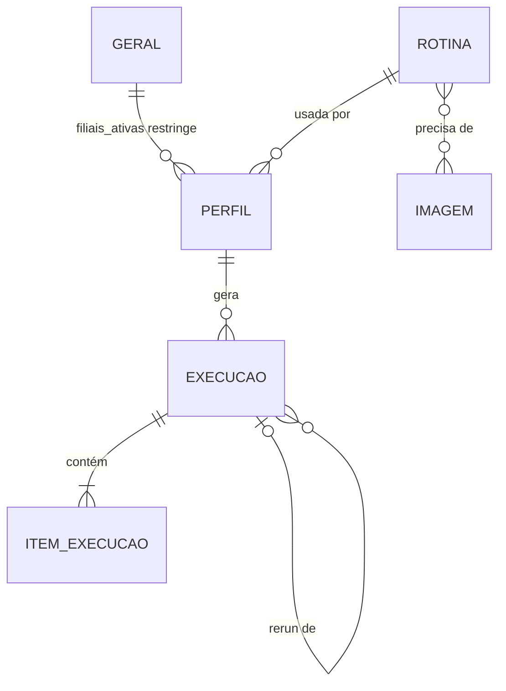

# Esquema de Backend — Automações Linear

- **Versão:** 1.4
- **Data:** 2026-11-10
- **Status:** aprovado
- **Base:** PRD v1.0, TRD v1.0, Fluxo v1.0

---

Na V1 **não há banco de dados**. Conforme o TRD, os dados ficam em **arquivos**:
- **YAML** para a configuração que você edita;
- **JSON** para o histórico que o robô grava.

Cada "tabela" abaixo é um tipo de arquivo. Os campos já foram pensados para virar tabelas SQLite sem mudar o significado quando a interface visual chegar.

## 1. Tabelas (arquivos)

### 1.1 `Geral` — `config/geral.yaml` (1 arquivo, versionado no Git)
| Campo | Tipo | Obrig. | Padrão | Observação |
|---|---|---|---|---|
| pasta_base | texto (caminho) | sim | `D:\Relatorios` | D-02 a confirmar |
| pasta_downloads | texto (caminho) | sim | `C:\Users\TI\Downloads` | |
| pasta_servidor | texto | sim | `robo_linear` | Pasta exclusiva do robô no Desktop do servidor (RN-13) |
| resolucao | texto | sim | `1920x1080` | Conferida na pré-checagem |
| tentativas | inteiro | sim | 3 | RN-07 |
| espera_max_comunicacao_s | inteiro | sim | 180 | D-05 |
| espera_padrao_s | inteiro | sim | 30 | Tempo máximo de cada passo |
| espera_download_s | inteiro | sim | 60 | |
| confianca_imagem | decimal 0–1 | sim | 0.9 | Precisão do reconhecimento de imagem |
| pausa_entre_acoes_ms | inteiro | sim | 400 | Pausa após cada clique, tecla ou digitação. Aumente se o ERP perder cliques |
| filiais_ativas | lista de inteiros | sim | as 22 do RN-01 | |
| grupos | mapa nome → lista de filiais | sim | os 4 do RN-11 | Cada filial do grupo precisa estar em `filiais_ativas`. Nomes sem acento nem espaço (`Seneto`, `Elenice`, `KazzaPop`, `Arunas`) |
| retencao_logs_dias | inteiro | sim | 90 | |

### 1.2 `Perfil` — `config/perfis/<id>.yaml` (1 por perfil, versionado)
| Campo | Tipo | Obrig. | Padrão | Observação |
|---|---|---|---|---|
| id | texto | sim | nome do arquivo | Chave. Ex.: `curva_abc` |
| nome | texto | sim | — | Ex.: "Curva ABC" |
| processo | texto PascalCase | sim | — | Usado no nome do arquivo e da pasta |
| rotina | texto | sim | — | → `Rotina.id` (ex.: `relatorio_padrao`) |
| menu | lista de textos | sim | — | Passos do menu (nomes das imagens). Ex.: `[menu_relatorios, menu_curva_abc]` |
| modelo_filtro | texto | sim | — | Nome do modelo salvo no ERP |
| opcao_relatorio | `analitico` \| `sintetico` | não | `analitico` | Marcada pelo robô depois das filiais |
| formato | `pdf` \| `xlsx` \| `ambos` | sim | `xlsx` | Padrão; pode ser trocado na execução |
| modo_filiais | `individual` \| `por_grupo` \| `consolidado` | sim | `individual` | Padrão; pode ser trocado na execução |
| filiais_padrao | lista de inteiros e/ou nomes de grupo, ou `todas` | sim | `todas` | Precisa estar contida em `Geral.filiais_ativas` |
| ativo | booleano | sim | `true` | Perfil inativo não aparece para execução |

### 1.3 `Rotina` — código em `linear/rotinas/<id>.py`
| Campo | Tipo | Obrig. | Observação |
|---|---|---|---|
| id | texto | sim | Nome do módulo. Chave |
| descricao | texto | sim | Texto de ajuda do módulo |
| imagens_necessarias | lista | sim | Nomes das imagens que a rotina usa; conferidos antes de rodar |

### 1.4 `Imagem` — `assets/imagens/<nome>.png` (versionado)
| Campo | Tipo | Obrig. | Observação |
|---|---|---|---|
| nome | texto | sim | Chave. Ex.: `btn_confirma`, `erro_msg_vermelha`, `erro_perda_comunicacao` |
| arquivo | PNG | sim | Recorte tirado em 1920x1080 |
| regiao (opcional) | x,y,l,a | não | Limita a busca a uma parte da tela, para ser mais rápido e seguro |

Catálogo em `assets/imagens/catalogo.yaml`, gerado por `ferramentas/recortar.py`. Ele tem três partes:
- `imagens`: nome → descrição, tela e região de busca opcional. A região é usada quando o mesmo texto aparece em mais de um lugar, como "Nome:" ou "Relatórios".
- `posicoes_fixas`: cliques por coordenada, em 1920x1080. São usados na barra do Terminal Server, que é semitransparente e muda de aparência conforme o fundo.
- `tipos_exportar`: a posição de cada tipo de arquivo na lista "Tipo" da janela Exportar. O tipo é escolhido pelo teclado.

### 1.5 `Execucao` — `execucoes/<id>.json` (1 por execução, **fora do Git**)
| Campo | Tipo | Obrig. | Padrão | Observação |
|---|---|---|---|---|
| id | texto | sim | `AAAA-MM-DD_HHMMSS` | Chave |
| perfil_id | texto | sim | — | → `Perfil.id` |
| modo_filiais | texto | sim | do perfil | O modo efetivamente usado |
| formato | texto | sim | do perfil | O formato efetivamente usado |
| periodo_de, periodo_ate | data | sim | ontem | RF-17 |
| filiais | lista de inteiros | sim | — | As filiais pedidas |
| origem | `run` \| `rerun` | sim | `run` | |
| execucao_origem_id | texto | não | null | → `Execucao.id` quando for rerun |
| inicio, fim | data-hora | sim / não | — | |
| status | `em_andamento` \| `concluida` \| `concluida_com_falhas` \| `abortada` | sim | `em_andamento` | |
| motivo_aborto | texto | não | null | |
| arquivo_log | texto | sim | — | Caminho do log |
| itens | lista de `ItemExecucao` | sim | [] | |

### 1.6 `ItemExecucao` (dentro de `Execucao.itens`)
| Campo | Tipo | Obrig. | Observação |
|---|---|---|---|
| escopo | texto | sim | `F03`, nome do grupo ou `Consolidado` (usado no nome do arquivo) |
| filiais | lista de inteiros | sim | As filiais marcadas nesse relatório |
| status | `ok` \| `falha` \| `sem_dados` \| `pendente` | sim | |
| tentativas | inteiro | sim | |
| arquivos_finais | lista de textos | não | Caminhos finais quando `ok` (2 no formato "ambos") |
| erros | lista de `{tentativa, passo (E-xx), tipo, mensagem, print}` | sim | Vazia quando não há erro |
| inicio, fim | data-hora | sim | |

## 2. Relacionamentos

## 3. Perfis de usuário e permissões
A V1 tem **um único usuário (Operador)**, que é você no próprio PC. O **Robô** também aparece na matriz porque grava arquivos.

| Dado | Operador | Robô |
|---|---|---|
| Geral | ver, editar | ver |
| Perfil | ver, criar, editar, inativar | ver |
| Rotina / Imagem | ver, criar, editar (com o Claude, pelo Git) | ver |
| Execucao / Item | ver, apagar (limpeza manual) | criar, editar a própria execução enquanto ela roda |
| Relatórios na pasta base | tudo | criar (nunca sobrescreve, RN-05), nunca apaga |
| Logs/prints | ver, apagar | criar; apagar só os mais antigos que `retencao_logs_dias` |

Na interface futura, se houver mais de um usuário, entra um perfil **Visualizador** (só vê o histórico e não roda nada). Isso só será decidido nessa etapa.

## 4. Validação e exclusão
- **Ao iniciar uma execução:**
  - o perfil existe e está ativo;
  - o `rotina` do perfil existe;
  - todas as imagens necessárias existem;
  - as filiais pedidas estão em `filiais_ativas`;
  - o `formato` e o `modo_filiais` são válidos;
  - os grupos citados existem e o período é válido (De ≤ Até);
  - a pasta base existe ou pode ser criada.

  Se qualquer item falhar, a execução é abortada **antes de clicar** e a mensagem diz o que corrigir.
- **Perfil:** não se apaga. Marca-se `ativo: false`, para manter o histórico legível.
- **Execuções:** nunca são editadas depois de terminar. Podem ser apagadas à mão.
- **Relatórios:** o robô nunca apaga nem sobrescreve.

## 5. Dados sensíveis
| Dado | Onde | Proteção |
|---|---|---|
| Token e chat_id do Telegram | `.env` | No `.gitignore`; existe só `.env.example` sem valores |
| Relatórios (dados da empresa) | pasta base | Fora do repositório |
| Prints de erro (podem mostrar dados do ERP) | `logs/prints/` | No `.gitignore`; apagados após 90 dias |
| Histórico de execuções | `execucoes/` | No `.gitignore` |
| Imagens de referência | `assets/imagens/` | **Vão para o GitHub público.** Só recortes pequenos de botões e mensagens, **sem** dados de clientes, produtos ou valores. Revisar cada recorte antes do commit |
| Senha do ERP | — | Não existe no projeto (RN-06) |

## 6. Ligação dados × telas
| Dado | Telas/passos |
|---|---|
| Geral | T-01 (pré-checagem), E-04 (filiais), organizador (pasta base) |
| Perfil | T-01 (`run`, `perfis`), E-02 (menu), E-03 (modelo), E-04 (modo), E-07 (formato) |
| Imagem | todos os E-xx e o vigia de erros |
| Execucao / Item | T-01 (progresso), T-02 (Telegram), T-03 (resumo), `rerun`, futuras UI-01/03/04 |

---

## Histórico de mudanças
| Versão | Data | Mudança |
|---|---|---|
| 0.1 | 2026-11-10 | Primeiro rascunho |
| 1.0 | 2026-11-10 | Aprovado |
| 1.4 | 2026-11-10 | `opcao_relatorio` no Perfil |
| 1.3 | 2026-11-10 | `pausa_entre_acoes_ms` em Geral |
| 1.2 | 2026-11-10 | Catálogo de imagens com regiões, posições fixas e tipos de exportação; `pasta_servidor` em Geral |
| 1.1 | 2026-11-10 | `grupos` em Geral; formato `ambos`; modo `por_grupo`; período e escopo na execução |
